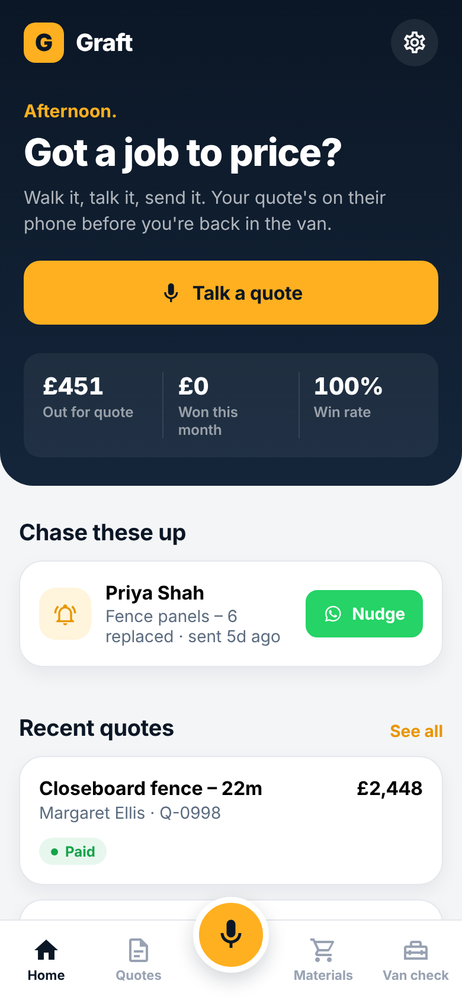

# Graft — quotes for UK trades

Talk through the job, get a priced, itemised quote, send it on WhatsApp. Built for self-employed UK tradespeople doing private domestic work (fencers, landscapers, plasterers, decorators, joiners and so on).

One codebase for **iOS and Android** (Expo / React Native), plus a small AI server.



## Features

| | |
|---|---|
| **Voice to quote** | On-device UK-English dictation biased towards trade vocabulary (closeboard, postcrete, Type 1, multi-finish…). The transcript is turned into labour, materials and waste lines at your day rate and markup. |
| **AI quoting** | `server/` sends the transcript, your rates and your most similar past jobs to Claude and returns structured quote JSON. With no signal or no server, an on-device parser (`src/lib/parser.ts`) still builds the draft. |
| **Job memory** | As you speak, past quotes are ranked by similarity (TF-IDF) and shown with what you charged. Tap to start from one. Your own last-used prices override catalogue prices. |
| **WhatsApp sending** | One tap opens WhatsApp to the client with a formatted, itemised quote. UK numbers are normalised (`07…` → `447…`). PDF quotes and invoices via the share sheet. |
| **Materials finder** | Say or type "4x4 8ft post", set a quantity and postcode (or use GPS), see merchants sorted cheapest first, tap through to the merchant to check live stock. |
| **Calculators** | Panel fence, closeboard, decking, patio, board & skim, paint, turf. One tap turns the take-off into a quote. |
| **Van check** | Tick-list per kit before you leave site; lend tools and see who's had what for how long. |
| **Pipeline** | Draft → Sent → Won → Invoiced → Paid, chase-up reminders with a pre-written nudge, win rate and work out for quote on the home screen. |
| **UK business setup** | VAT (20%) toggle and number, deposit %, payment terms, bank details, quote numbering. |

## Run it

```bash
npm install
npm run web          # quick look in a browser
npx expo run:ios     # or run:android — needs a dev build (speech recognition is a native module)
npm test             # unit tests for pricing, parsing, memory, WhatsApp, calculators
npm run typecheck
```

Voice uses `expo-speech-recognition`, which is not in Expo Go, so use a development build (`npx expo run:ios|android` or `eas build --profile development`). In a browser, dictation works in Chrome.

### AI server

```bash
cd server
npm install
ANTHROPIC_API_KEY=sk-ant-... npm start        # listens on :8787
```

Then point the app at it: copy `.env.example` to `.env` and set `EXPO_PUBLIC_QUOTE_API_URL`. Set `GRAFT_APP_TOKEN` on the server and `EXPO_PUBLIC_QUOTE_API_TOKEN` in the app to require a shared token. The API key stays on the server, never in the app. The server uses Claude structured outputs so the response always matches the quote schema, with server-side model fallback enabled.

### Ship to the stores

```bash
npx eas-cli@latest build --platform all --profile production
npx eas-cli@latest submit --platform all
```

Bundle ID / package: `uk.co.graftapp`. Store listing copy, keywords and brand kit: [`marketing/APP_STORE.md`](marketing/APP_STORE.md). Landing page: [`marketing/index.html`](marketing/index.html).

## Project layout

```
src/app/            screens (Expo Router)
  (tabs)/           Home, Quotes, [mic], Materials, Van check
  new.tsx           voice capture + job memory
  quote/[id].tsx    quote editor, WhatsApp/PDF/invoice
  settings.tsx      business profile & rates
src/lib/            pure logic (tested): money, parser, memory, materials, calculators, whatsapp
server/             Claude-backed quote API
marketing/          landing page, store copy, screenshots
```

## Before launch

- **Live material prices.** `src/lib/materials.ts` ships with guide trade prices and deep links into each merchant's search. UK merchants don't offer open price APIs, so real-time prices need a trade-account integration or a price-data partner. Plug it in with `setPriceProvider()`; the UI already labels prices as guide or live.
- **App icon & splash.** `assets/` has a simple amber "G" on ink generated in code. Get a designer to produce the final mark.
- **Accounts & sync.** Data is stored on the device (AsyncStorage). The Crew plan on the landing page needs a backend for shared price books.
- **Pricing.** The plans on the landing page (£0 / £12.99 / £29.99) are suggestions.
